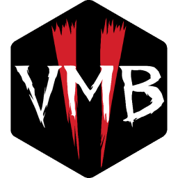

## Vermintide Mod Builder  

A Windows CLI program created to ease the ever-growing pain of creating, building and uploading mods for Vermintide. Works for both Vermintide 1 and 2.    

Made in [Node.js](https://nodejs.org/en/). Compiled with [pkg](https://github.com/zeit/pkg).

### Prerequisites

1. Vermintide Mod SDK must be installed. Look for *"Warhammer: End Times - Vermintide Mod SDK Pre-Alpha"* for Vermintide 1 and *"Warhammer: Vermintide 2 SDK (Alpha)"* for Vermintide 2 in the Tools section in your Steam library.  
4. [V1 ONLY] For now, to enable mods in the launcher, find `launcher.config` in `%AppData%\Fatshark\Warhammer End Times Vermintide` and set `ModsEnabled` to `true`, or add `ModsEnabled = true` if it is missing.  
3. Steam must be running for creating, publishing and uploading mods. 
4. Subscribe to Vermintide Mod Framework on Steam workshop ([V1 version](https://steamcommunity.com/sharedfiles/filedetails/?id=1289946781), [V2 version](https://steamcommunity.com/sharedfiles/filedetails/?id=1369573612)) and make sure that it is the first mod in the list in the launcher if you want VMF-dependent mods to work.

### Quickstart Guide

1. Download and export **[the latest release](https://github.com/Vermintide-Mod-Framework/Vermintide-Mod-Builder/releases/latest)**.  
2. Run `vmb config` to create default .vmbrc config file in the folder with the executable.  
3. Set `game` in .vmbrc to 1 or 2 to determine for which game mods are going to be created, built and uploaded by default.   
4. Run `vmb create <mod_name>` to create a new mod. This will create a new VMF-dependent mod in the `mods` folder from a template and then open a steam workshop page where you will have to subscribe to the mod in order for the game to recognize it.     
5. The main functionality of your mod should be added to `<mod_name>/scripts/mods/<mod_name>/<mod_name>.lua`.  
6. To build the mod, run `vmb build <mod_name>`.  
7. To upload an updated version of your mod, run `vmb upload <mod_name>`.  
8. To re-publish a mod if you deleted it from the workshop, or to publish it for another game, run `vmb publish <mod_name> -g {1|2}`.
You'll need to delete the `published_id` line from the mod's .cfg file when re-publishing.  
9. To submit a mod for sanctioning, follow these steps:
    1. Set `apply_for_sanctioned_status` to true in the mod's .cfg file.
    2. `vmb build mod --source`
    3. `vmb upload mod`

### Usage

	vmb <command> [command-specific params]
	
See **[wiki](https://github.com/Vermintide-Mod-Framework/Vermintide-Mod-Builder/wiki)**.

### Using the game's resources

A mod can only use resources the compiler can find. By default that is the mod's own folder and the SDK's `core` folder. To let it use more, for example the game's units from the Modding Tools Content, list their folders in `map_source_dirs` in .vmbrc. Each entry names a top-level folder and the folder that contains it:

	"map_source_dirs": [
		{ "name": "units", "dir": "C:/Program Files (x86)/Steam/steamapps/common/Vermintide 2 Modding Tools Content/content" }
	]

The compiler compiles everything in its source folder, and these folders hold most of the game. So vmb doesn't give it them: it follows the resource paths the mod's files refer to, and the paths those files refer to in turn, copies the mod and only the files found to `source` in the mod's temp folder, and compiles from there.

An entry can also name a single file in the top folder, which is always copied. The compiler only reads top-level files from its source folder, and the game's flow needs its custom flow nodes:

	{ "name": "global.script_flow_nodes", "dir": "C:/Program Files (x86)/Steam/steamapps/common/Vermintide 2 Modding Tools Content/content" }

Each build writes the files it found to `mapped_sources.txt` in the mod's folder, one per line. Commit it with the mod to see what the mod takes from the game and how that changes. `vmb build <mod_name> --no-resolve-deps` builds from that list instead of finding the files again.

### Making levels

The level editor only works in its project, the Modding Tools Content. `vmb add-level <mod_name> <level_name>` keeps the level in the mod and lets the editor work on it there:

- it makes `levels/<mod_name>/<level_name>/world.level` in the mod, a level with the game's skydome and one of its environments
- it links the Content's `levels/<mod_name>` folder to the mod's, so the editor opens and saves the mod's own files
- it registers the level with the Content's `mod_tools` DLC, as `LevelSettings.<level_name>`, so it can be played from ToolCenter with `-auto-host-level <level_name>`

Adding the level to the mod's own scripts and package is left to you. It also runs `vmb setup-content`, which adds `editor_requires.lua` to the Content: the editor's Ledgelator and Path Generator need game scripts that only the game's own boot loads.

### Building VMB executable

	npm run setup   
	npm run build

Alongside the executable, a zip archive will be created with template and mods folders included.

### Tests

    npm test
